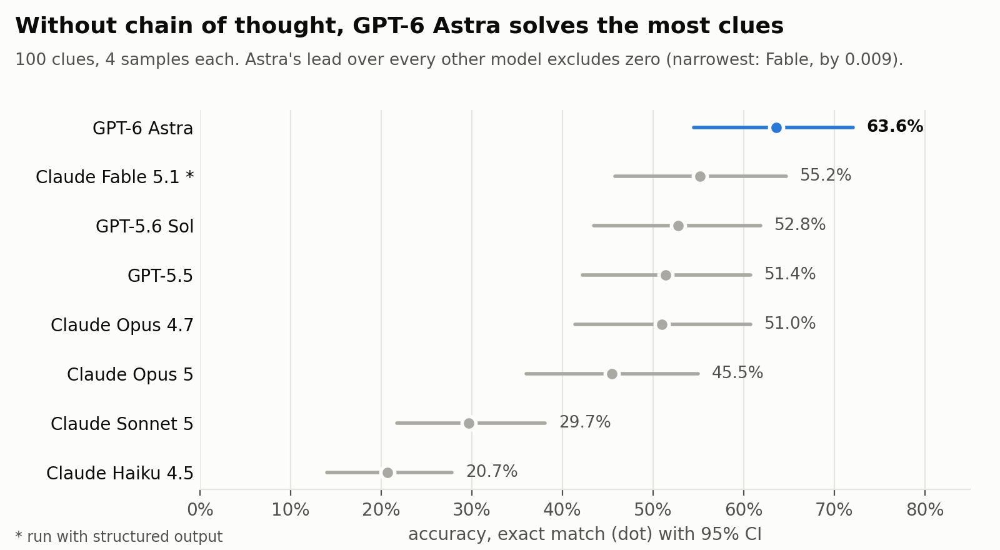
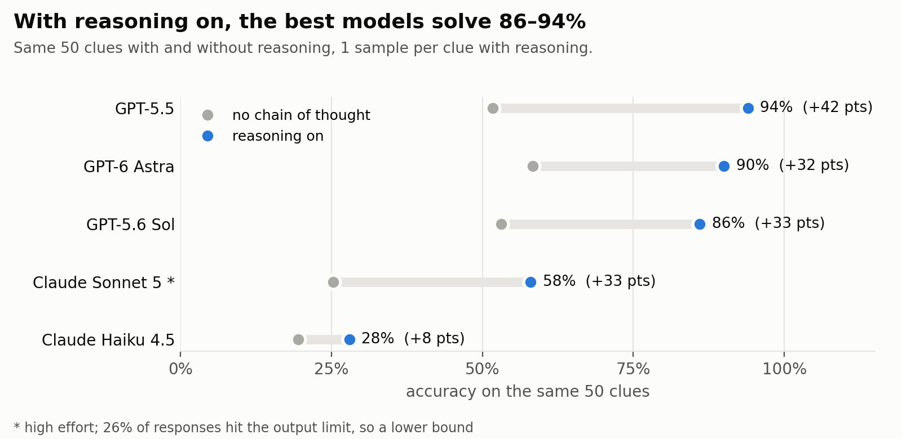
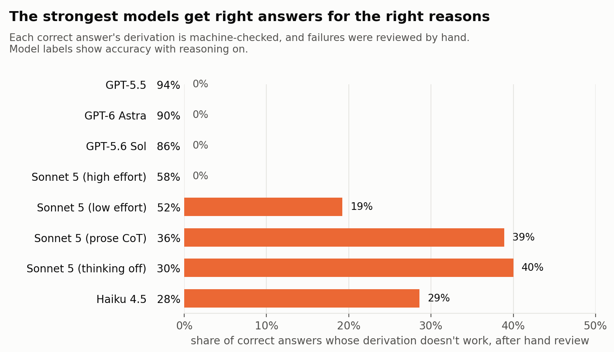

# CrypticBench

How well do frontier models solve cryptic crossword clues without chain of thought, and how
much does reasoning add? Eight models tested on 100 clues I wrote + whether the models could 
produce correct clue derivations.



**Key findings**

- **GPT-6 Astra is the best no-CoT solver**, at 64%, ahead of all seven other models.
- **With reasoning on, the best models solve 86–94%**, gaining around 30–40 points.
- **The strongest models get right answers for the right reasons.** No correct answer from
  GPT-5.5, Astra or Sol rested on broken working. Right answers with wrong working only show
  up in weaker models.
- **A reasoning-token count of zero doesn't mean the model didn't reason.** One model reported
  zero reasoning tokens while visibly working through clues in its answer.

## Method

- **An original test set.** 100 cryptic clues written by the author (plus 4 used as worked
  examples), which aren't in any public dataset.
- **Checkable reasoning.** Models with reasoning on fill in a seven-field
  derivation (definition, device, indicator, fodder, operation, result, answer). A checker
  runs it: an anagram must be a rearrangement of the fodder's letters, a hidden word must be in
  the clue, and so on. So "right answer" and "right reasoning" are scored separately.
- **"No chain of thought" verified on every call.** Some models can't have reasoning switched
  off, only asked off. The harness reads each call's reasoning-token count and excludes any call
  that reasoned.
- **A pre-registered analysis.** Hypotheses and tests were frozen
  ([`docs/analysis_plan.md`](docs/analysis_plan.md)) before the full run, and every deviation
  is recorded in its Outcome section.
- **Reproducible runs.** Eight models were run through OpenRouter, with a manifest per run
  recording the exact model, config, prompt and dataset hashes.
- **Edge cases reviewed by hand.** All 53 derivations the checker rejected behind correct
  answers were reviewed, and all 909 distinct wrong answers were graded blind to which model
  gave them, in case any were valid alternatives. None were, so the scores are final.

## Results

### Reasoning adds 30–40 points for strong models



On a 50-clue subset, reasoning lifts GPT-5.5 from 52% to 94%. Astra gains about as much as
Sol and Sonnet 5 (around 32 points), so its no-CoT lead isn't explained by needing chain of
thought less. Haiku 4.5 barely improves.

### Strong models' working holds up



For GPT-5.5, Astra, Sol and high-effort Sonnet 5, every derivation the checker rejected behind
a correct answer turned out, on review, to be a correct parse its grammar couldn't express
(for example a container nested inside another). For the weaker settings, many were genuinely
wrong: the answer was right but the stated working doesn't produce it. Double definitions and
&lit clues can't be machine-checked and are left out.

### Caveats

- Astra's lead over Claude Fable 5.1 is narrow (the paired interval clears zero by 0.009),
  and on 200 public Guardian clues (an exploratory run) it shrinks from 8 points to 2.
- Fable 5.1 was run with structured output, because without it it reasoned in its answer.
- High-effort Sonnet 5 hit the output limit on 26% of clues, so its score is a lower bound.
  Truncation rose with effort (4%, 16%, 26%), so a fixed output limit understates the top of
  any reasoning-effort curve.

The numbers behind every chart are in [`results/summary/`](results/summary/), and the full
pre-registered verdicts are in [`docs/analysis_plan.md`](docs/analysis_plan.md).

## Repository

| path | contents |
|---|---|
| `figures/`, `results/summary/` | the charts above and the numbers behind them |
| `docs/analysis_plan.md` | the frozen pre-registration and its Outcome section |
| `docs/runbook.md` | how to run a study with the harness, step by step |
| `docs/data.md` | where every data file comes from, and what isn't included |
| `run.py` | the runner: model calls and the reasoning check |
| `src/crypticbench/` | the derivation template, checker, corpus handling |
| `tasks/`, `prompts/` | the no-CoT and reasoning tasks, and their versioned prompts |
| `configs/models.yaml` | each model's route and settings |
| `analysis/` | metrics, figures and the review viewer |
| `results/runs/` | one manifest per run (no clue text or answers) |
| `data/review/` | the setter's answer and derivation rulings (no clue text) |
| `tests/` | test suite, using invented clues |

## Running it

```
uv venv --python 3.10 && uv sync --all-extras
cp .env.example .env                      # add OPENROUTER_API_KEY
uv run pytest
uv run python analysis/summary_figures.py # redraw the charts
```

The clues aren't included, so to run models you'll need your own (format in
[`data/README.md`](data/README.md)) or the public Guardian and Times sets, which
`tools/fetch_calibration.py` and `tools/build_times200.py` download. The full procedure is in
[`docs/runbook.md`](docs/runbook.md).

## Data and licence

The clues are withheld so they stay usable as a test set. Code is MIT; data terms are in
[`LICENSE-DATA`](LICENSE-DATA) and [`docs/data.md`](docs/data.md). To cite, see
[`CITATION.cff`](CITATION.cff).
