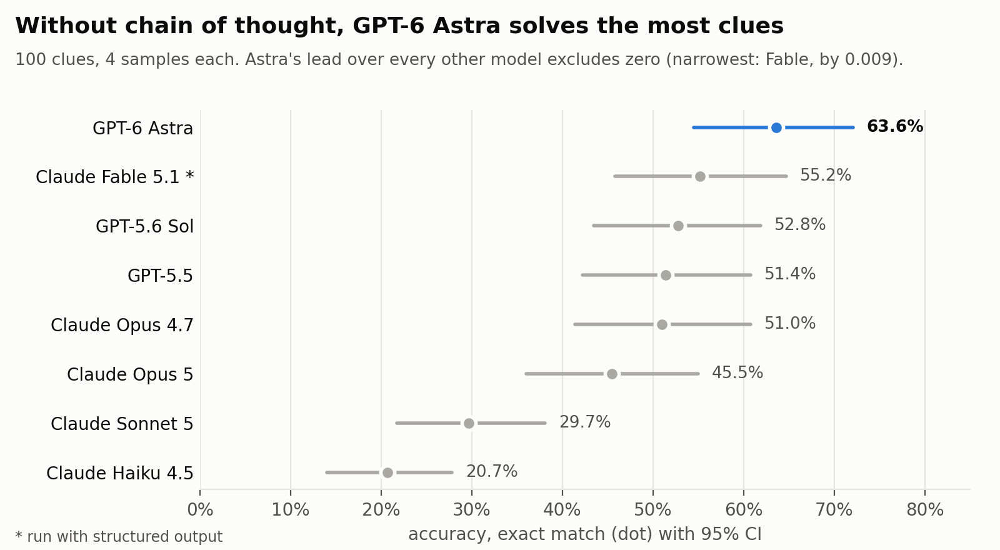
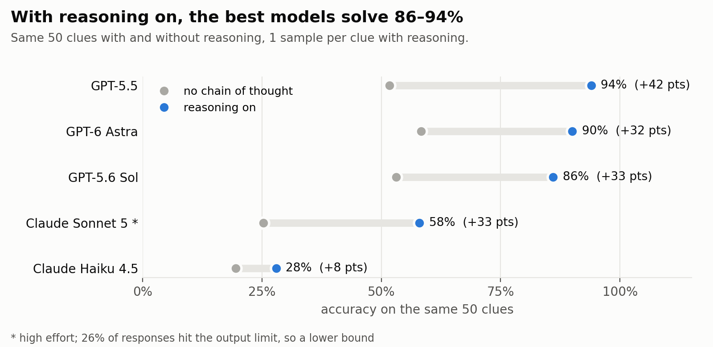
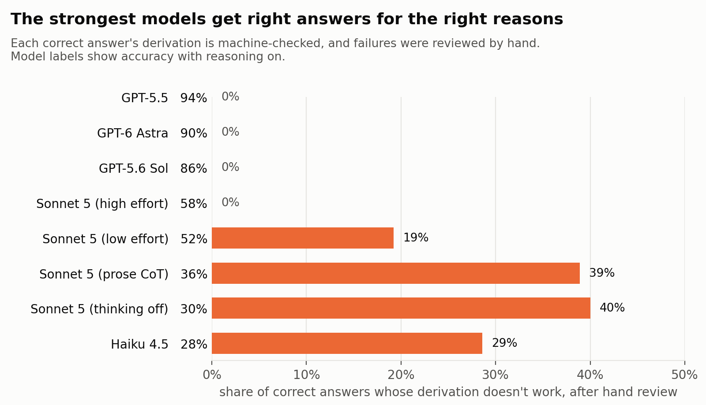

# CrypticBench

**Testing frontier models on 100 of my own cryptic crossword clues, both with and without CoT**

Eight models were tested on two conditions: answer
immediately with no chain of thought, or reason first and write out a derivation (which can be easily verified). This means we can distinguish "got it right" from "got it right for the right reason".



## Key findings

- **GPT-6 Astra is the best solver without chain of thought**, at 64%. The next best is
  Claude Fable 5.1 at 55%, and the weakest is Claude Haiku 4.5 at 21%.
- **Reasoning adds 30–40 points for the strong models.** With it, GPT-5.5 solves 94%, Astra 90%
  and GPT-5.6 Sol 86%.
- **The strongest models get right answers for the right reasons.** After hand review, no
  correct answer from GPT-5.5, Astra, Sol or high-effort Sonnet 5 rested on broken working.
  Right answers with wrong working only show up in the weaker settings.
- **A reasoning-token count of zero doesn't mean the model didn't reason.** One model reported
  zero reasoning tokens while visibly working through clues in its answer.

## At a glance

**No chain of thought**: 100 clues, 4 samples each, 95% CIs.

| model | accuracy | 95% CI |
|---|---|---|
| GPT-6 Astra | **0.64** | 0.55 – 0.72 |
| Claude Fable 5.1 ¹ | 0.55 | 0.46 – 0.65 |
| GPT-5.6 Sol | 0.53 | 0.44 – 0.62 |
| GPT-5.5 | 0.51 | 0.42 – 0.61 |
| Claude Opus 4.7 | 0.51 | 0.41 – 0.61 |
| Claude Opus 5 | 0.46 | 0.36 – 0.55 |
| Claude Sonnet 5 | 0.30 | 0.22 – 0.38 |
| Claude Haiku 4.5 | 0.21 | 0.14 – 0.28 |

¹ Run with structured output, because without it Fable reasoned inside its answer.

**With reasoning on**: a fixed 50-clue subset.

| model | no CoT | reasoning on | gain |
|---|---|---|---|
| GPT-5.5 | 0.52 | **0.94** | +0.42 |
| GPT-6 Astra | 0.58 | 0.90 | +0.32 |
| GPT-5.6 Sol | 0.53 | 0.86 | +0.33 |
| Claude Sonnet 5 (high effort) ² | 0.25 | 0.58 | +0.33 |
| Claude Haiku 4.5 | 0.20 | 0.28 | +0.09 |

² 26% of its answers hit the output limit, so this is a lower bound.

Full numbers, with confidence intervals on every difference, are in
[`results/summary/`](results/summary/).

## How a derivation is checked

With reasoning on, each model ends with a seven-field block. Take an invented clue:

> *Sing air wildly, lifting* (7)

```
DEFINITION: lifting
DEVICE:     anagram
INDICATOR:  wildly
FODDER:     Sing air [literal] -> SINGAIR
OPERATION:  anagram of SING AIR
RESULT:     RAISING
ANSWER:     RAISING
```

The checker then verifies four things:

1. the block parses;
2. the definition and the fodder are separate spans of the clue;
3. the operation really produces the result (here, that RAISING uses exactly the letters of
   SINGAIR);
4. the result is the answer.

An answer can be correct while the derivation fails, and that gap is the derivation-quality
result below. Double definitions and &lit clues can't be executed, so they're marked
unscoreable rather than wrong.

## Results

### Reasoning adds 30–40 points for strong models



Astra gains about as much as Sol and Sonnet 5 (around 32 points), so its no-CoT lead isn't
explained by it needing chain of thought less. Haiku 4.5 barely improves.

### Strong models' working holds up



All 53 derivations the checker rejected behind a correct answer were reviewed by hand. For
GPT-5.5, Astra, Sol and high-effort Sonnet 5, every one was a correct parse that the checker's
grammar couldn't express, such as a container nested inside another. For the weaker settings
many were genuinely wrong: the answer was right, but the stated working doesn't produce it.

### Caveats

- **Astra's lead over Fable is narrow.** The paired interval clears zero by 0.009. On 200
  public Guardian clues (an exploratory run) the gap shrinks from 8 points to 2.
- **Fable 5.1 was measured differently** (structured output; see ¹ above).
- **Fixed output limits understate the top of an effort curve.** Truncation rose with
  Sonnet 5's reasoning effort (4%, 16%, 26%), so the condition that reasons most is the one cut
  off most often.

## Method

- **An original test set.** 100 clues written by me, plus 4 used as worked examples. None are in
  any public dataset, and they're withheld here so they stay usable as a test set.
- **No-CoT verified on every call.** Some models can't have reasoning switched off, only asked
  off. The harness reads each call's reasoning-token count and excludes any call that reasoned.
- **Pre-registered.** Hypotheses and tests were frozen in
  [`docs/analysis_plan.md`](docs/analysis_plan.md) before the full run, and every deviation is
  recorded in its Outcome section.
- **Reproducible.** All models were run through OpenRouter, with a manifest per run recording
  the exact model, config, prompt and dataset hashes.
- **Wrong answers graded blind.** All 909 distinct wrong answers were graded without knowing
  which model gave them, in case any were valid alternatives. None were, so the scores are
  final.

## Running it

```
uv venv --python 3.10 && uv sync --all-extras
cp .env.example .env                      # add OPENROUTER_API_KEY
uv run pytest                             # no network needed
uv run python analysis/summary_figures.py # redraw the charts
```

The clues aren't included. To run models, bring your own (format in
[`data/README.md`](data/README.md)) or use the public Guardian and Times sets, which
`tools/fetch_calibration.py` and `tools/build_times200.py` download. The full procedure is in
[`docs/runbook.md`](docs/runbook.md).

## Repository

| path | contents |
|---|---|
| `figures/`, `results/summary/` | the charts above and the numbers behind them |
| `docs/analysis_plan.md` | the frozen pre-registration and its Outcome section |
| `docs/runbook.md` | how to run a study with the harness, step by step |
| `docs/data.md` | where every data file comes from, and what isn't included |
| `run.py` | the runner: model calls and the reasoning check |
| `src/crypticbench/` | the derivation template, checker and corpus handling |
| `tasks/`, `prompts/` | the no-CoT and reasoning tasks, and their versioned prompts |
| `configs/models.yaml` | each model's route and settings |
| `analysis/` | metrics, figures and the review viewer |
| `results/runs/` | one manifest per run (no clue text or answers) |
| `data/review/` | the setter's answer and derivation rulings (no clue text) |
| `tests/` | test suite, using invented clues |
